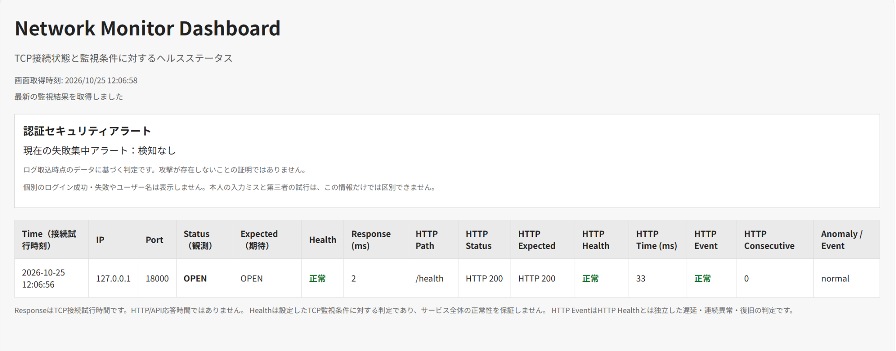
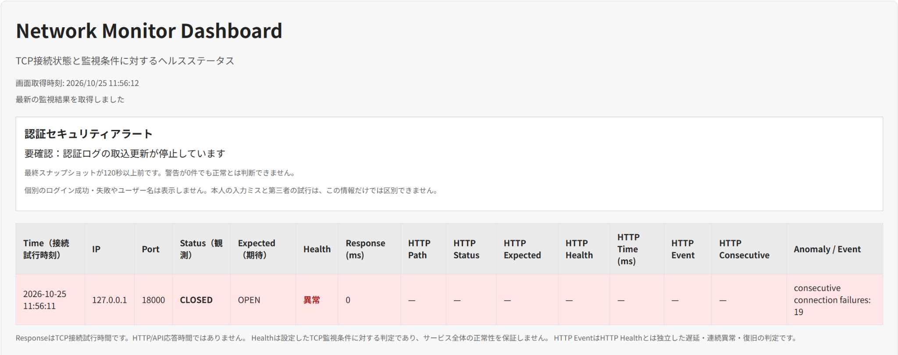

# Network Monitor

**Webサービスの通信状態とログインの異常を確認する、C言語製の監視ツールです。**

Webサービスは、接続できても正しく応答しているとは限りません。このツールは、通信の成否、Web APIからの応答、ログイン失敗の状況をそれぞれ確認し、結果をブラウザに表示します。

大学で学んだネットワークとセキュリティの知識を、実際に動くプログラムとして確かめるために個人開発しました。

## 動作画面

### 通信・認証監視の画面



*開発環境での実際の表示（2026年10月25日）。TCP接続は成功し、確認用APIも想定どおりの「HTTP 200」を返しています。画面上部では、ログイン失敗が短時間に集中していないことも確認できます。*

画面に表示される主な項目は、接続できたか、応答にかかった時間、APIから返された結果、設定した正常条件に一致するか、の4点です。

### ログ収集を停止したときの画面



*認証ログの定期収集を意図的に停止した際の表示。警告が0件でも、記録が更新されていなければ「正常」とは扱いません。*

## 開発のきっかけ

最初に作ったのは、指定したサーバーへ接続できるかを調べるプログラムです。しかし、接続の成功・失敗だけでは、一時的な不調なのか、障害が続いているのか、サービスが正しい応答を返しているのかを判断できません。

そこで、過去の監視結果との比較や、Web APIの応答確認を追加しました。さらに、模擬金融APIで発生したログイン失敗も調べられるようにし、**何が起きたために異常と判断したのか**を確認できる構成にしました。

## できること

| 監視するもの | 確認できる内容 | 例えば |
| --- | --- | --- |
| **通信状態（TCP）** | サーバーに接続できるか、接続にかかった時間、失敗が続いているか | サービスへの接続が3回続けて失敗した |
| **Web APIの応答（HTTP）** | 指定したURLから期待した応答が返るか、応答が遅くなっていないか | 接続はできるが、APIがエラーを返した |
| **ログインの記録** | 同じ送信元IPアドレス、または同じユーザー名で失敗が集中していないか | 60秒以内にログイン失敗が5回発生した |
| **ログの収集状況** | 最新の記録を取得できているか | 収集が止まったため、現在の状態を確認できない |

監視結果はWeb画面で確認でき、TCP・HTTPの結果はCSV形式でも記録します。CSVは表計算ソフトなどで開けるテキスト形式です。

**注意：** ログイン失敗が集中しても、それだけで第三者による攻撃と断定することはできません。入力ミスなどでも発生するため、調査のきっかけとなる情報として扱います。

## 仕組み

このツールには、2つの監視方法があります。

**① 通信・Web APIの監視**

指定したサーバーにC言語のプログラムから接続し、接続結果とHTTP応答を確認します。測定した結果は、ブラウザの画面とCSVに反映します。

**② ログイン記録の監視**

開発環境では、実験用に用意したWeb APIの認証記録を別のプログラムで取得・整理し、C言語の監視ツールに読み込ませました。失敗が短時間に集中しているかだけでなく、**ログの取得処理が止まっていないか**も確認します。

公開しているのはC言語の監視ツールと画面・テストコードです。実験に使った模擬金融APIとログの定期収集プログラムは、現時点ではこのリポジトリに含めていません。そのため、**このリポジトリだけで認証ログの自動取得までは再現できません**。

詳しい構成と設計上の判断は [設計資料](docs/ARCHITECTURE.md) に記載しています。

## 使用した技術

| 技術 | 用途 |
| --- | --- |
| **C言語** | 通信処理、監視結果の記録、異常の判定を実装 |
| **TCPソケット** | 指定したサーバーへの接続を確認 |
| **pthread / mutex** | 複数のポートを並行して監視し、共有データを安全に更新 |
| **HTTP / JSON** | Web APIの応答確認と監視結果の画面表示 |
| **Linux（WSL Debian）** | C言語監視ツールの開発・動作確認 |
| **Ubuntu Server / FastAPI** | 監視対象となる模擬金融APIの構築（開発環境） |

C言語を選んだのは、通信や並列処理をライブラリ任せにせず、ソケット通信やエラー処理を自分で理解して実装したかったためです。

## 動かしてみる

Linux環境で、GCC・makeを使用します。以下はDebian・Ubuntu系Linuxでの例です。

**1. 監視ツールを取得する**

```bash
git clone https://github.com/I-Takayama/network-monitor-security.git
cd network-monitor-security
cp data/config.example.txt data/config.txt
make
```

**2. 監視するWebサービスを用意する**

初期設定では `127.0.0.1:18000/health` からHTTP 200が返ることを想定しています。実際の模擬金融APIは同梱していないため、動作を試す場合は別途Webサービスが必要です。

例えばPython 3が入っている場合は、別の端末で次の簡易Webサーバーを起動できます。

```bash
python3 -m http.server 18000 --bind 127.0.0.1
```

この簡易サーバーは `/` に応答するため、監視側の `data/config.txt` の `http_path=/health` を `http_path=/` に変更してください。

**3. 監視を開始する**

```bash
./monitor
```

ブラウザで `http://127.0.0.1:8082/` を開くと、監視結果を確認できます。終了するときは、起動した端末で `Ctrl+C` を押します。

> **補足：** この簡易例で確認できるのはTCP・HTTP監視です。認証監視を使用するには、別途ログデータを用意する必要があります。初めて起動したときに認証欄へ「情報を取得できない」と表示されても、通信監視の失敗を意味するものではありません。

設定項目や認証ログの入力形式、トラブル時の確認方法は [運用手順](docs/OPERATIONS.md) を参照してください。

## 検証結果

2026年10月25日、公開用のソースコードを別の作業環境でビルドし、**142項目の確認をすべて通過**しました。通信状態や異常判定のテストに加え、実際にHTTP通信を発生させるテストも含まれています。

| 確認した内容 | 結果 |
| --- | --- |
| TCP・HTTP監視の動作と異常判定 | 113項目合格 |
| ログイン失敗の検知、収集状況の判定、警告記録 | 29項目合格 |
| **合計** | **142項目合格** |

開発環境では、模擬金融APIへのログイン失敗を発生させ、ログの取得から警告の記録までを確認しました。また、定期収集の停止を検知できることと、同じログを重複して取り込まないことも検証しました。

実際の検証ログの一部：

```text
RELEASE_FULL_BUILD=PASS
TOTAL_REGRESSION_CHECKS=142_PASS
RELEASE_WEB_ALERT=PASS
RELEASE_WEB_STALE=PASS
```

検証の条件と範囲は [テスト結果](docs/TEST_EVIDENCE.md) にまとめています。

## 現時点での範囲

このプロジェクトは、学習と実験のために作成したものです。実際の金融機関のシステムを監視したものではありません。また、接続やHTTP応答が正常でも、サービスのすべての機能が正常に動作しているとは限りません。

認証失敗から攻撃者を特定する機能や、障害の原因を自動的に特定する機能は備えていません。長期間の運用や大規模環境での性能評価も行っていません。

Web画面は検証用の簡易サーバーで提供しており、C言語の実装はIPv4の `127.0.0.1` で待ち受けます。インターネットへの公開を想定したものではありません。

---

**関連資料：** [設計・技術選定](docs/ARCHITECTURE.md) · [実行・運用手順](docs/OPERATIONS.md) · [検証記録](docs/TEST_EVIDENCE.md)
